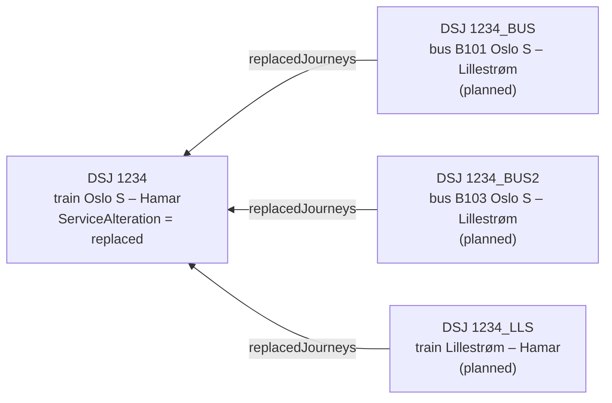
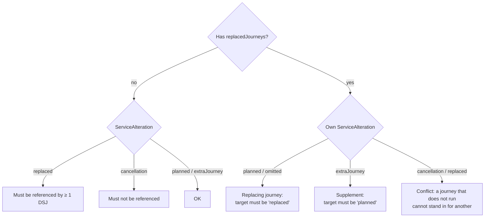

# 🔀 Deviation Handling with DatedServiceJourney

> [!NOTE]
> **Draft.** The rules reflect how data consumers interpret deviations today. Rules marked *convention* are established practice, not schema constraints. Review before publishing.

## 1. Introduction

The yearly timetable describes what *should* run. On a given day, track work, crew shortages, broken vehicles and events change that. In the Nordic Profile, **DatedServiceJourney** (DSJ) is where these day-specific changes are expressed. It is the dated, versioned instance of a ServiceJourney, and its id is the stable key that sales, passenger information and real-time feeds bind to.

Two small fields carry the whole model: `ServiceAlteration` (what happened to *this* journey) and `replacedJourneys` (which journey *this* one stands in for). Getting either of them on the wrong journey makes consumers show the wrong thing to travellers. This guide makes the rules explicit.

In this guide you will learn:
- What `planned`, `cancellation`, `replaced` and `extraJourney` mean, and which journey carries each value
- Which direction replacement references point, with complete before/after examples
- How to model partial replacement, an altered stretch, and combinations of train and bus
- Which consistency checks to run: missing references, conflicting statuses, several journeys on one date
- How each deviation should be presented to travellers

---

## 2. The four ServiceAlteration values

`ServiceAlteration` always describes the journey it sits on. It never describes another journey.

| Value | Meaning for *this* DSJ | Typical companion |
|-------|------------------------|-------------------|
| `planned` (or omitted) | Runs as published. Also used for a new journey that replaces another. | `replacedJourneys` is **required** when it replaces something |
| `cancellation` | Does not run, and **no alternative** is offered | Nothing references it |
| `replaced` | Does not run as planned, and **one or more other DSJs take over** all or part of it | At least one other DSJ references it via `replacedJourneys` (rare exception: see check C3) |
| `extraJourney` | Runs **in addition** to the plan | No references (pure extra), or `replacedJourneys` pointing to the journey it supplements (see 4f) |

> [!WARNING]
> `replaced` goes on the **original** journey, not on the new one. The new journey is the one travellers should use, so it is `planned` (or omitted).

---

## 3. Direction of replacement references

`replacedJourneys/DatedVehicleJourneyRef` sits on the **new** journey and points **back** to the original. The original never points forward to its replacements. Consumers find the replacements by looking up which DSJs reference the original.



<details><summary>Text version</summary>

```text
  DSJ 1234_BUS (planned) ──replacedJourneys──▶ DSJ 1234 (replaced)
  DSJ 1234_BUS2 (planned) ─replacedJourneys──▶ DSJ 1234 (replaced)
  DSJ 1234_LLS (planned) ──replacedJourneys──▶ DSJ 1234 (replaced)
```
</details>

Rules:
- A journey that replaces another **always** carries `replacedJourneys` pointing back to it. Without the back-reference there is no replacement in the data, only an unrelated new journey.
- A DSJ is a **journey**, not a vehicle. If the vehicle on a replacement changes (another bus serves the same trip), update that same DSJ with a new version. Do not create a new replacement.
- References always point to the **root original**. If a genuinely new journey takes over, it also points to the original, never to an intermediate replacement (no chains).
- Keep the original and its replacements on the same **OperatingDay** as a rule of thumb. A different OperatingDay is allowed, but it adds complexity, for example around daylight saving time changes.
- The original keeps its **id**. Only its `version` increases. Tickets sold against the id remain valid references.
- Once published within the sales window, the original is **never removed** from the data. Every deviation is expressed by changing it, never by leaving it out (see C11).

### Before and after

The full examples describe the same Saturday on a fictional line R10, Oslo S – Lillestrøm – Eidsvoll – Hamar.

- **Before:** [Example_DeviationHandling_Before.xml](Example_DeviationHandling_Before.xml) has three trains, all `planned`, version 1.
- **After:** [Example_DeviationHandling_After.xml](Example_DeviationHandling_After.xml) adds track work between Oslo S and Lillestrøm, one cancellation and one supplementary bus.

| Train | Before | After | What changed in the data |
|-------|--------|-------|--------------------------|
| 1234 | `planned` v1 | `replaced` v2 | Plus three new DSJs referencing it: two parallel buses Oslo S – Lillestrøm and a shortened train Lillestrøm – Hamar |
| 1236 | `planned` v1 | `cancellation` v2 | Nothing references it |
| 1238 | `planned` v1 | `planned` v1 (unchanged) | Plus a new `extraJourney` bus referencing it as a supplement |

```xml
<!-- BEFORE -->
<DatedServiceJourney id="NP:DatedServiceJourney:1234_2026-11-14" version="1">
  <ServiceJourneyRef ref="NP:ServiceJourney:R10_1234"/>
  <OperatingDayRef ref="NP:OperatingDay:2026-11-14"/>
</DatedServiceJourney>

<!-- AFTER: same id, new version, status on the original -->
<DatedServiceJourney id="NP:DatedServiceJourney:1234_2026-11-14" version="2">
  <ServiceAlteration>replaced</ServiceAlteration>
  <ServiceJourneyRef ref="NP:ServiceJourney:R10_1234"/>
  <OperatingDayRef ref="NP:OperatingDay:2026-11-14"/>
</DatedServiceJourney>

<!-- AFTER: new journey points back to the original -->
<DatedServiceJourney id="NP:DatedServiceJourney:1234_BUS_2026-11-14" version="1">
  <ServiceJourneyRef ref="NP:ServiceJourney:R10_1234_BUS"/>
  <replacedJourneys>
    <DatedVehicleJourneyRef ref="NP:DatedServiceJourney:1234_2026-11-14"/>
  </replacedJourneys>
  <OperatingDayRef ref="NP:OperatingDay:2026-11-14"/>
</DatedServiceJourney>
```

---

## 4. Scenarios

### 4a. Full replacement

A bus runs the whole stretch instead of the train. Set the original to `replaced`. Create one DSJ for the bus with `replacedJourneys` pointing to the original. The bus has its own ServiceJourney with `TransportMode=bus` and `BusSubmode=railReplacementBus`, its own stops (often different quays or stop places), and its own times.

The bus stays on the **same Line** as the train. It is the same line being operated, and the same products apply. Only the trip is run by a vehicle that cannot use the track, so the mode is set on the ServiceJourney, not on the Line.

### 4b. Partial replacement and altered stretch

Only part of the stretch is closed. The original is still set to `replaced`, because it does not run *as planned*. Each stretch is then covered by its own new DSJ:

| Stretch | New DSJ | Mode | ServiceJourney |
|---------|---------|------|----------------|
| Oslo S – Lillestrøm | `1234_BUS`, `1234_BUS2` | bus (`railReplacementBus`) | New, bus stops and times (one per bus, see 4c) |
| Lillestrøm – Hamar | `1234_LLS` | rail | New, shortened JourneyPattern |

All new DSJs reference the same original. Together they should cover every stop of the original. A gap means some travellers have no journey (see check C7).

The shortened train keeps the commercial train number (`PublicCode` 1234). The bus gets its own human-readable identifier (`PublicCode` B101). The link to the train comes from `replacedJourneys`, not from a shared number. Keep commercial and operational train numbers apart: the commercial number belongs in `PublicCode` on the ServiceJourney, the operational number on TrainBlockPart. See [Rolling Stock](../RollingStock/RollingStock_Guide.md).

> [!NOTE]
> **Open point.** Planners find it easier to look up everything under the commercial train number, including the replacement buses. A separate bus identifier is cleaner for travellers and fits the requirement (TAP TSI) that `PublicCode` carries the commercial train number. The trade-off is not settled yet.

For modelling the transfer between the bus and the shortened train, see the [Interchange guide](../Interchange/Interchange_Guide.md).

> [!NOTE]
> **Alternative for minor changes.** For a small change that keeps one vehicle and one mode (for example a skipped stop or a different quay), you can keep the DSJ id and point it to a new ServiceJourney. The DSJ `version` **must** then increase by one. The version increase is the signal that something changed. Consumers compare the fields of the two versions (ServiceJourneyRef, and through it stops and times) to find out what. This keeps the sales key stable. Use the `replaced` pattern whenever the stretch is split across vehicles or modes.

### 4c. Several buses for one train

A train carries far more people than a bus, so one train is often replaced by several buses. Sometimes the buses run different stretches. Sometimes they share the same planned route and times, and are only there for capacity.

Give **every bus its own DSJ**, with its own ServiceJourney and its own identifier (`PublicCode` B101, B103), even when stops and times are identical. Each one references the original train.

Downstream, each bus has its own real-time feed (position, delay, occupancy). That information needs an identifier to attach to. Send the buses as separate journeys in the planned data. Do not leave it to the real-time service to split or aggregate one planned journey across several vehicles.

### 4d. Cancellation without alternative

Set `ServiceAlteration=cancellation` and increase the version. No other DSJ may reference it. If something does replace it, use `replaced` instead.

### 4e. Extra journey

A journey that is not in the plan, for example for an event. Use `ServiceAlteration=extraJourney` and no `replacedJourneys`.

An extra journey always has its **own ServiceJourney**. It almost always has departure times, identifiers or stops that differ from the planned journeys, so it cannot reuse their template.

```xml
<DatedServiceJourney id="NP:DatedServiceJourney:1290_2026-11-14" version="1">
  <ServiceAlteration>extraJourney</ServiceAlteration>
  <ServiceJourneyRef ref="NP:ServiceJourney:R10_1290"/>
  <OperatingDayRef ref="NP:OperatingDay:2026-11-14"/>
</DatedServiceJourney>
```

### 4f. Supplement (reduced capacity)

Reduced capacity (fewer carriages) is **not** a deviation in this sense. The journey still runs, so it stays `planned`.

When the train cannot carry everyone, add a supplementary bus. It is an `extraJourney` with `replacedJourneys` pointing to the train.

> [!NOTE]
> **Convention.** `extraJourney` combined with `replacedJourneys` means *supplements*, not *replaces*. In NeTEx 2.0 the generic link (`DatedServiceJourneyRef`) was replaced by `replacedJourneys`, so a supplement no longer has a neutral way to point to the journey it supports. Reusing `replacedJourneys` is semantically unfortunate, but it is the only link available. Consumers must read the pair together.

### 4g. Revert

The track work is postponed. Set the original back to `planned` with a new version, and leave the replacements out of the next delivery. Together, the version increase on the original and the missing replacements are enough for consumers to detect the revert.

| Version | Original 1234 | Bus 1234_BUS |
|---------|---------------|--------------|
| 1 | `planned` | not yet created |
| 2 | `replaced` | v1 `planned`, references 1234 |
| 3 | `planned` | no longer delivered |

You may also keep a replacement in the delivery with `ServiceAlteration=cancellation` and a new version. That is useful when tickets have been sold against the replacement itself, but it is not required.

---

## 5. Consistency checks

Run these checks on the full set of DSJs in the dataset, not on one delivery file alone. A reference can point to a DSJ on another OperatingDay (see C2), so do not limit the lookup to a single day.

Severity levels: **Error** must be fixed before publishing. **Warning** should be fixed, but the data can be published. **Info** needs a manual check.

| # | Check | Rule | Severity |
|---|-------|------|----------|
| C1 | Dangling reference | Every `replacedJourneys/DatedVehicleJourneyRef` resolves to an existing DSJ | Error |
| C2 | Same day | A replacing DSJ and the DSJ it references have the same OperatingDay. Allowed to differ, but check times carefully across daylight saving changes. | Warning |
| C3 | Replaced without replacement | A DSJ with `replaced` is referenced by at least one other DSJ. If not, consumers can only treat it as a cancellation. Rare exception: the journey is replaced by ordinary scheduled service outside the submitter's data responsibility. A [Notice](../../objects/Notice/Table_Notice.md) assigned to the DSJ, telling travellers about the alternative, is then **mandatory**. | Error unless a Notice is assigned |
| C4 | Reference to a running journey | A DSJ that is `planned` is only referenced by `extraJourney` DSJs (supplements). A `planned` replacing journey must point to a `replaced` original. | Error |
| C5 | Reference to a cancelled journey | A DSJ with `cancellation` is not referenced. If something replaces it, it should be `replaced`. | Error |
| C6 | Chains and self-references | A referenced original does not itself carry `replacedJourneys`. A DSJ does not reference itself. Point to the root original. | Error |
| C7 | Coverage | The replacing DSJs together serve every stop of the original. Replacement buses often use other quays or a nearby stop place, so check this manually for now. | Info |
| C8 | Cancelled replacement | If every replacement of a `replaced` original is cancelled, the original should be `planned` again (revert) or `cancellation` | Warning |
| C9 | Duplicate dated instance | At most one DSJ per ServiceJourney and OperatingDay. This includes extra journeys, which have their own ServiceJourney. | Warning |
| C10 | Version | Any change to a DSJ (`ServiceAlteration`, `ServiceJourneyRef`, `replacedJourneys`, `BlockRef`) comes with a version one higher than the last delivered version | Warning |
| C11 | Removed original | An original DSJ (one without `replacedJourneys`) that has been published within the sales window is never removed from later deliveries. Change it with `ServiceAlteration` and a new version instead. Tickets may have been sold against it, so the number of sales on the journey is a useful cross-check. | Error |

> [!NOTE]
> C7 could be automated if stop places that serve the same station were grouped, for example with GroupOfStopPlaces and a [PurposeOfGrouping](../../objects/PurposeOfGrouping/Table_PurposeOfGrouping.md) for replacement transport. That grouping does not exist in the data today.



---

## 6. How to present deviations to travellers

The data must let a traveller answer three questions: *Does my journey run? If not, what do I take instead? What is different about it?*

| Situation | Original journey | New journey |
|-----------|------------------|-------------|
| Full replacement | Show as cancelled, **with a link** to the replacement: "Replaced by bus 07:35 from Oslo S" | Show as normal departure, labelled "Bus for train 1234" |
| Partial replacement | Show as cancelled on the affected stretch only. Show the full trip as one itinerary: bus Oslo S – Lillestrøm, then train Lillestrøm – Hamar. | Each piece labelled with its own identifier, the train it replaces and the transfer point ("Bus B101 for train 1234, change at Lillestrøm") |
| Several buses | Show as cancelled, with links to all replacing buses | Show each bus as its own departure with its own identifier and real-time status ("Bus B101 and B103 for train 1234") |
| Cancellation | Show as cancelled, suggest the next departure | — |
| Extra journey | — | Show as normal, optionally labelled "Extra departure" |
| Supplement | Show as normal, optionally "Reduced capacity, extra bus available" | Show as "Extra bus for train 1238" |
| Revert | Show as normal again, notify ticket holders | Remove, notify anyone booked on it |

Recommendations:
- ✅ Never hide a `replaced` journey without a pointer to its replacement. A traveller searching by train number must find the bus.
- ✅ Show replacement buses with their own departure time and stop. These often differ from the train's (07:35 from the bus terminal, not 08:02 from platform 4).
- ✅ Use [Notice](../../objects/Notice/Table_Notice.md) for the reason and practical text. See [Passenger Information](../PassengerInformation/PassengerInformation_Guide.md).
- ✅ Treat a version increase on a DSJ that has sold tickets as a trigger to notify the ticket holder.
- ❌ Do not present a supplement (`extraJourney` + `replacedJourneys`) as a replacement. The train still runs.

The same deviation should also be reflected in real-time channels (SIRI ET cancellation, SIRI SX situation), so planned and real-time information agree.

---

## 7. Common mistakes

| Mistake | Effect | Fix |
|---------|--------|-----|
| `replaced` on the new journey | The bus looks like it does not run, and the train looks like it runs | `replaced` on the original. The new journey is `planned`. |
| Reference from original to replacement | Consumers cannot find the pair | `replacedJourneys` on the new journey, pointing back |
| `cancellation` when a bus is provided | Traveller sees "cancelled" with no alternative | Use `replaced` |
| Replacement points to another replacement | Chains break grouping logic | Point to the root original |
| New DSJ id for the original | Tickets lose their anchor | Keep the id, increase the version |
| Revert without a new version on the original | Consumers do not notice the change, and the bus stays linked to a journey that now runs | Set the original to `planned` with a higher version |
| Changed ServiceJourneyRef without a new version | Consumers keep the old stops and times | Increase the DSJ version on every change |
| Original marked `replaced` for reduced capacity | Train disappears from the journey planner | Keep it `planned` and add an `extraJourney` supplement |
| One DSJ for several parallel buses | Real-time data from each bus has no journey to attach to, and the buses get merged or mixed up downstream | One DSJ, ServiceJourney and identifier per bus, all referencing the original |

---

## 8. Related resources

### Guides
- [How to Build a Timetable](../HowToBuildATimetable/HowToBuildATimetable_Guide.md) – From Line to DatedServiceJourney
- [Calendar](../Calendar/Calendar_Guide.md) – OperatingDay versus DayType
- [Interchange](../Interchange/Interchange_Guide.md) – Transfers between replacement bus and train
- [Passenger Information](../PassengerInformation/PassengerInformation_Guide.md) – Notices and displays

### Objects & frames
- [DatedServiceJourney](../../objects/DatedServiceJourney/Table_DatedServiceJourney.md) – Element-level specification
- [ServiceJourney](../../objects/ServiceJourney/Table_ServiceJourney.md) – The reusable template
- [OperatingDay](../../objects/OperatingDay/Table_OperatingDay.md) – The calendar date a DSJ belongs to
- [Line](../../objects/Line/Table_Line.md) – TransportMode and TransportSubmode
- [TimetableFrame](../../frames/TimetableFrame/Table_TimetableFrame.md) – Carries ServiceJourney and DatedServiceJourney
