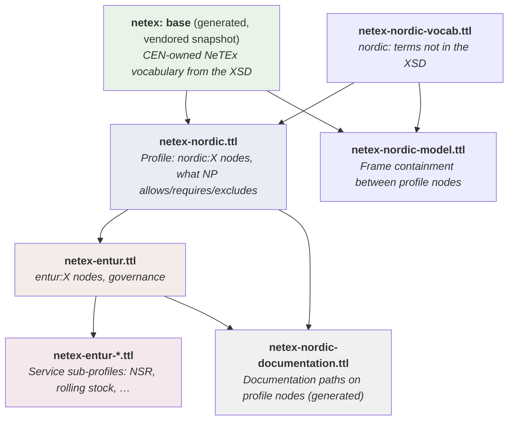

# 🧠 Ontology Guide

## 1. 🎯 Introduction

This repository includes a machine-readable ontology — a set of `.ttl` (Turtle/RDF) files that model the NeTEx schema, Nordic Profile constraints, and Entur-specific governance as structured, queryable data.

> ℹ️ **Scope of this guide.** The only ontology file *native* to this repository is [`netex-nordic-documentation.ttl`](../../ontology/netex-nordic-documentation.ttl) — the documentation layer, generated from the `objects/` and `frames/` folders, that links each Nordic and Entur profile class to its Description/Table/Example files. Every other layer (the generated base, the Nordic Profile, and the Entur layers) lives in the `entur-netex-ontology` and `nordic-netex-ontology` **submodules**, which each carry their own README as the **authoritative, up-to-date source** for their internals. This guide gives a stable conceptual orientation to the whole stack; when submodule detail and this guide disagree, trust the submodule README.

The ontology serves two purposes:
- **For humans:** a precise, navigable reference for how NeTEx classes, references, and constraints relate to each other.
- **For machines:** a foundation for automated validation (SHACL), documentation generation, and tooling integration.

**In this guide you will learn:**
- 📂 The file structure and layer stack
- 🔤 What the standard prefixes (RDF, OWL, SHACL, SKOS) mean
- 🛠️ Where and why custom properties are used
- ✅ How SHACL shapes enable validation
- 🔗 How the layers connect

---

## 2. 📂 File Structure

The `ontology/` folder contains a documentation-specific file alongside the [`entur-netex-ontology`](https://github.com/entur/entur-netex-ontology) submodule (the single source of truth for all non-documentation ontology files):

```
ontology/
  ├── entur-netex-ontology/            ← git submodule (https://github.com/entur/entur-netex-ontology)
  │   ├── netex-entur.ttl                    ← Entur profile nodes (entur:X) and governance
  │   ├── netex-entur-*.ttl                  ← Entur service sub-profiles (NSR, rolling stock, …)
  │   └── nordic-netex-ontology/             ← nested submodule (https://github.com/entur/nordic-netex-ontology)
  │       ├── base/                          ← vendored snapshot of the generated NeTEx base (netex.ttl + modules + SHACL)
  │       ├── netex-nordic.ttl               ← Nordic Profile (profile nodes, SHACL constraints, element ordering)
  │       ├── netex-nordic-vocab.ttl         ← Nordic (nordic:) and shared profile (profile:) vocabulary
  │       ├── netex-nordic-model.ttl         ← Curated frame containment between profile nodes
  │       ├── netex-transmodel-alignment.ttl ← NeTEx ⇄ Transmodel mapping (skos)
  │       └── netex-siri-bridge.ttl          ← NeTEx ⇄ SIRI real-time bridges
  └── netex-nordic-documentation.ttl   ← Documentation paths on profile nodes (generated)
```

> ℹ️ **Filenames drift; layers don't.** The submodules add and rename files over time (new service sub-profiles, module splits). Treat the tree above as illustrative and rely on the **layer roles** below rather than exact filenames.

> ℹ️ The NeTEx **base vocabulary** (`netex:`) is **generated from the NeTEx XSD** and intended to be CEN-owned — the profile never hand-edits it. A snapshot of that generated base is **vendored under `base/`** in the `nordic-netex-ontology` submodule (the `netex.ttl` root plus its per-module documents and a SHACL baseline), so the profile stays self-contained and validatable without fetching anything external. Terms keep their `netex:` identity regardless of where the base is hosted.

### Import Chain

The ontology layers build on imported dependencies. The documentation layer imports both the Nordic Profile and Entur ontology so it can link to the profile nodes they define:



> `netex-transmodel-alignment.ttl` and `netex-siri-bridge.ttl` sit in the Nordic layer beside `netex-nordic-model.ttl`, adding `skos` alignment to Transmodel and the NeTEx ⇄ SIRI bridge respectively.

### What Each File Does

| File | Role | Contains |
|------|------|----------|
| `base/` (generated snapshot) | **Generated base** | OWL classes + `lowerCamelCase` properties + XSD cardinality/sequence, projected from the NeTEx XSD (CEN-owned); vendored, not hand-edited |
| `netex-nordic.ttl` | **Nordic Profile** | Profile membership (`nordic:X` profile nodes and their fields), SHACL validation shapes (excludes, requires, allows), element ordering |
| `netex-nordic-vocab.ttl` | **Nordic vocabulary** | Shared `profile:` terms (profile nodes, members, scope, ordering) and `nordic:` terms not derived from the XSD (provenance, data confidence, domain chains, structural predicates, SIRI bridge property) |
| `netex-nordic-model.ttl` | **Nordic model** | Curated frame containment between profile nodes (`nordic:contains`/`containedIn`) |
| `netex-transmodel-alignment.ttl` | **Alignment** | `skos` mapping from NeTEx classes to Transmodel concepts |
| `netex-siri-bridge.ttl` | **SIRI bridge** | Which NeTEx classes are referenced by SIRI real-time services |
| `netex-entur.ttl` | **Entur profile** | `entur:X` profile nodes for Entur-only classes (inheriting the Nordic Profile), codespace conventions, data ownership, Partner portal modules |
| `netex-entur-*.ttl` | **Service sub-profiles** | One file per Entur service (NSR stop places, rolling stock, inventory, product, income model, …). Each imports `netex-entur.ttl` as a **peer** and adds service-specific SHACL constraints; a delivery is validated only against the sub-profiles relevant to its purpose |
| `netex-nordic-documentation.ttl` | **Documentation layer** | Description/Table/Example paths on the profile nodes, and guides with the classes they cover; generated by `scripts/generate_documentation_ttl.py` |

---

## 3. 🔤 Standard Prefixes

The ontology uses four W3C standard vocabularies. Each has a specific job:

### `rdfs:` — RDF Schema

Basic building blocks for naming and structuring things.

```turtle
netex:Line a owl:Class ;
    rdfs:label "Line" ;                  ## Human-readable name
    rdfs:subClassOf netex:Organisation . ## Inheritance
    rdfs:comment "Also used in SIRI" .   ## Free-text note
```

**Used for:** `rdfs:label`, `rdfs:subClassOf`, `rdfs:comment`, `rdfs:seeAlso`, `rdfs:range`

### `owl:` — Web Ontology Language

Formal class and property declarations with logical semantics.

```turtle
netex:Line a owl:Class .                             ## Class declaration
nordic:contains a owl:ObjectProperty .              ## Relates two things
profile:position a owl:DatatypeProperty .           ## Relates thing to a value
nordic:containedIn owl:inverseOf nordic:contains .  ## Inverse relationship
```

**Used for:** `owl:Class`, `owl:ObjectProperty`, `owl:DatatypeProperty`, `owl:inverseOf`, `owl:Ontology`, `owl:imports`

### `skos:` — Simple Knowledge Organization System

Definitions and concept alignment across standards.

```turtle
netex:Line
    skos:definition "Public transport service line..." ;  ## Precise definition
    skos:exactMatch tm-journeys:Line .                    ## Same concept in Transmodel
```

**Used for:** `skos:definition`, `skos:exactMatch`, `skos:closeMatch`, `skos:notation`

### `sh:` — SHACL (Shapes Constraint Language)

Validation rules that tools can execute against real data.

```turtle
profile:NP_JourneyPatternShape a sh:NodeShape ;
    sh:targetClass netex:JourneyPattern ;
    sh:property [
        sh:path netex:routeRef ;
        sh:minCount 1 ; sh:maxCount 1 ;       ## "Must have exactly one"
        sh:class netex:Route ;                 ## "Must point to a Route"
    ] .
```

**Used for:** `sh:NodeShape`, `sh:targetClass`, `sh:property`, `sh:path`, `sh:minCount`, `sh:maxCount`, `sh:class`, `sh:name`, `sh:description`

### Quick Reference

| Prefix | Full Name | One-line summary |
|--------|-----------|-----------------|
| `rdfs:` | RDF Schema | Names things and declares inheritance |
| `owl:` | Web Ontology Language | Declares classes and typed properties |
| `skos:` | Simple Knowledge Organization System | Defines terms and maps between vocabularies |
| `sh:` | SHACL | Validates data against rules |

Alongside these, four **domain namespaces** carry the model itself:

| Prefix | Namespace | Owner | Role |
|--------|-----------|-------|------|
| `netex:` | `https://netex-cen.eu/ontology#` | CEN (generated from XSD) | Base classes & properties |
| `nordic:` | `https://netex-cen.eu/nordic#` | Nordic editorial team | Profile vocabulary, structural model, SIRI bridge |
| `profile:` | `https://netex-cen.eu/profile#` | Nordic editorial team | Profile definition & SHACL shapes |
| `entur:` | `https://entur.org/ontology#` | Entur | Governance, codespaces, sub-profiles |

---

## 4. 🛠️ Custom Properties

Beyond the standard W3C vocabularies, the ontology relies on two families of domain terms: **generated `netex:` properties** projected 1:1 from the NeTEx XSD (`lowerCamelCase`, e.g. `netex:routeRef`) that live in the generated, CEN-owned base, and **hand-authored `nordic:` predicates** for profile navigation, declared in `netex-nordic-vocab.ttl` and applied in `netex-nordic-model.ttl`.

### Why a Separate `nordic:` Namespace?

The generated base intentionally mints **no terms beyond the XSD**, so anything the profile invents lives in `nordic:` — keeping the CEN-owned `netex:` namespace clean and regenerable.

1. **No XSD equivalent exists** — the XML containment hierarchy (`nordic:contains`, `nordic:containedIn`, `nordic:inFrame`) has no counterpart in the schema. There's no standard way to say "this class appears as a child element inside this frame in the XML".

2. **Functional specialisation, deliberately not `rdfs:subClassOf`** — the Entur profile records with `entur:specializes` that `DatedServiceJourney` specialises `ServiceJourney`, without letting a reasoner infer a true IS-A hierarchy the standard never formalised.

3. **XSD cardinality lives in the generated base** — the base carries cardinality and element sequence via `owl:Restriction`, so the profile no longer maintains hand-written named-reference resources.

### Profile Nodes (`profile:ProfileClass`)

A statement may only sit on a `netex:` class if it is true of NeTEx regardless of any profile. Everything a profile decides — that it includes a class, which fields it uses, in which order, inside which frame — is stated on a node the profile **owns**, which points at the standard class:

```turtle
nordic:Quay a profile:ProfileClass ;
    profile:onClass netex:Quay ;     ## the CEN class being profiled
    profile:scope profile:NP .       ## the profile that governs this node

[] a profile:ProfileMember ;
    profile:memberOf nordic:Quay ;
    profile:path "Quay/Name" ;
    profile:cardinality "1..1" .
```

The Nordic Profile mints `nordic:X` nodes; Entur mints `entur:X` nodes for the classes it adds (for example `entur:DatedServiceJourney`). Because each profile has its own node, the same CEN class can be profiled — and documented — by several profiles without their statements mixing.

### Structural Predicates (`nordic:`)

These model the XML containment hierarchy — how classes nest inside frames and each other. Declared in `netex-nordic-vocab.ttl` and asserted between **profile nodes** in `netex-nordic-model.ttl`:

| Property | Meaning | Example |
|----------|---------|---------|
| `nordic:contains` | Frame/object contains these child classes | `nordic:ResourceFrame contains nordic:Authority, nordic:Operator, …` |
| `nordic:containedIn` | Inverse of contains; also used for inline children | `nordic:Quay containedIn nordic:StopPlace` |
| `nordic:inFrame` | Top-level member of a frame type | `Line inFrame ServiceFrame` |

### Generated Reference Properties (`netex:`)

Named references are **no longer hand-modelled**. Each reference is a generated `lowerCamelCase` property projected from the XSD, and profile constraints target it directly by URI:

```turtle
## Generated base: the property exists, projected 1:1 from the XSD
netex:routeRef a owl:ObjectProperty .

## netex-nordic.ttl: a SHACL shape tightens it for the profile
profile:NP_JourneyPatternShape a sh:NodeShape ;
    sh:targetClass netex:JourneyPattern ;
    sh:property [
        sh:path netex:routeRef ;         ## the generated property
        sh:minCount 1 ; sh:maxCount 1 ;  ## NP mandates 1..1 (XSD allows 0..1)
        sh:class netex:Route
    ] .
```

SHACL shapes, profile constraints, and service sub-profiles all reference these generated properties by URI.

---

## 5. ✅ SHACL Validation

SHACL shapes in `netex-nordic.ttl` and the Entur service sub-profiles (`netex-entur-*.ttl`, e.g. NSR and rolling stock) express constraints that standard tools can validate automatically.

### What SHACL Expresses

| Constraint Type | SHACL Pattern | Example |
|----------------|---------------|---------|
| **Excluded** (forbidden) | `sh:maxCount 0` | `ParentSiteRef` not used in NP |
| **Allowed** (optional) | `sh:maxCount 1` | `TopographicPlaceRef` allowed but not required |
| **Required** (mandatory) | `sh:minCount 1; sh:maxCount 1` | `RouteRef` mandatory in NP (XSD says optional) |
| **Type check** | `sh:class` | `RouteRef` must point to a `Route` |

### Shape Naming Convention

| File | Pattern | Example |
|------|---------|---------|
| `netex-nordic.ttl` | `profile:NP_{ClassName}Shape` | `profile:NP_JourneyPatternShape` |
| `netex-entur-nsr.ttl` | `nsr:NSR_{ClassName}Shape` | `nsr:NSR_StopPlaceShape` |
| `netex-entur-rolling-stock.ttl` | `svc:RS_{ClassName}Shape` | `svc:RS_DatedServiceJourneyShape` |

Each service sub-profile uses its own prefix and shape prefix (e.g. `inv:INV_…` for inventory), following the same `{PREFIX}_{ClassName}Shape` pattern.

### Layered Validation

Because the files form an import chain, constraints are additive:

1. **XSD** validates basic XML structure (element names, types, nesting)
2. **NP shapes** validate Nordic Profile rules (tighter than XSD)
3. **Service shapes** validate system-specific requirements (tighter than NP)

A DatedServiceJourney delivery to the rolling stock service must pass all three layers.

---

## 6. 🔗 How It All Connects

### From Ontology to Documentation

The `netex-nordic-documentation.ttl` file bridges the ontology to the repository's Description/Table/Example files. Documentation links sit on the profile node, not on the CEN class:

```turtle
nordic:ServiceJourney
    doc:description "objects/ServiceJourney/Description_ServiceJourney.md" ;
    doc:table "objects/ServiceJourney/Table_ServiceJourney.md" ;
    doc:example "objects/ServiceJourney/Example_ServiceJourney_NP.xml" .
```

This enables tools and LLM agents to navigate from a class URI to its full documentation: find the profile node with `profile:onClass netex:ServiceJourney`, then follow its `doc:` links. The node's `profile:scope` tells you whether the documentation describes the Nordic Profile (`profile:NP`) or an Entur addition (`profile:Entur`).

The file is **generated** — never edit it by hand. Each `objects/<Class>/` or `frames/<Class>/` folder becomes one entry, linked to the Nordic node for `netex:<Class>` (or the Entur node when Nordic has none), and each `guides/<Guide>/` folder becomes a guide entry:

```bash
python scripts/generate_documentation_ttl.py           # regenerate after adding or renaming files
python scripts/generate_documentation_ttl.py --check   # what CI runs (via validate_ontology.py)
```

You can document a class before any profile includes it. If no profile node exists yet, the documentation sits on a node owned by this repository and points at the class with `doc:forClass`:

```turtle
unprofiled:Direction
    a doc:UnprofiledDocumentation ;
    doc:forClass netex:Direction ;
    doc:description "objects/Direction/Description_Direction.md" .
```

CI and the nightly ingest PR show a warning for every such class, as a signal to add it to a profile upstream in `entur-netex-ontology`. When the profile node appears, the next regeneration moves the documentation onto it. CI also warns about profile classes that have no documentation folder yet. It fails only when a folder name is not a NeTEx class, a folder has neither a Description nor a Table file, or the committed file is stale.

### From Ontology to Guides

Guides are linked too. Each guide is a `doc:Guide` with its markdown file, its examples and a `doc:covers` link to every documented class it links to in the text:

```turtle
guide:Calendar
    a doc:Guide ;
    rdfs:label "Calendar — When Services Operate" ;
    doc:path "guides/Calendar/Calendar_Guide.md" ;
    doc:example "guides/Calendar/Example_Calendar.xml" ;
    doc:covers entur:DatedServiceJourney ;
    doc:covers nordic:DayType ;
    doc:covers nordic:OperatingDay .
```

Follow `doc:covers` in reverse to find the guides that explain a class. The links are read from the guide's own markdown, so a guide covers a class as soon as it links to that class's documentation folder.

### From Ontology to Validation

A SHACL shape references a generated property from the NeTEx base:

```
generated base:   netex:routeRef        (XSD cardinality 0..1, via owl:Restriction)
                              ↓
netex-nordic.ttl: sh:path netex:routeRef
                  sh:minCount 1          (NP tightens to 1..1)
```

### From Ontology to SIRI

The `nordic:referencedBySIRI` property (declared in `netex-nordic-vocab.ttl`, asserted in `netex-siri-bridge.ttl`) shows which NeTEx classes appear in SIRI real-time feeds:

```turtle
netex:Line nordic:referencedBySIRI siri:SIRI_ET , siri:SIRI_SX , siri:SIRI_VM , siri:SIRI_FM .
```

This makes it possible to trace which NeTEx data must be stable for SIRI interoperability.

---

## 7. 📚 Further Reading

**Authoritative sources for submodule internals** (kept current upstream):

- [nordic-netex-ontology README](https://github.com/entur/nordic-netex-ontology) — The generated base (`base/`), Nordic Profile, vocabulary, model, and cross-standard alignment
- [entur-netex-ontology README](https://github.com/entur/entur-netex-ontology) — Entur governance and the service sub-profiles (`netex-entur-*.ttl`)

**Standards:**

- [W3C RDF Primer](https://www.w3.org/TR/rdf11-primer/) — Introduction to RDF and Turtle syntax
- [W3C OWL 2 Overview](https://www.w3.org/TR/owl2-overview/) — Formal ontology language
- [W3C SHACL Specification](https://www.w3.org/TR/shacl/) — Shapes Constraint Language
- [W3C SKOS Reference](https://www.w3.org/TR/skos-reference/) — Simple Knowledge Organization System
- [Transmodel](https://www.transmodel-cen.eu/) — The conceptual model behind NeTEx
